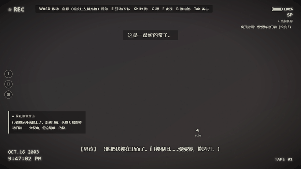
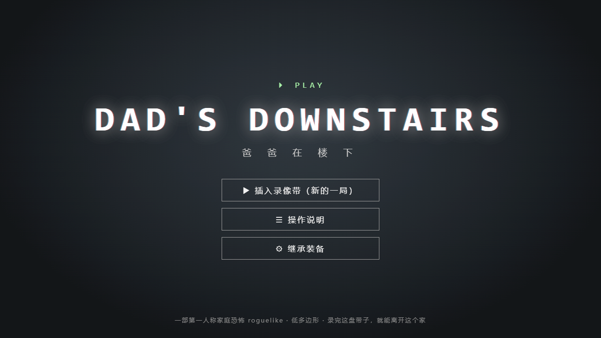
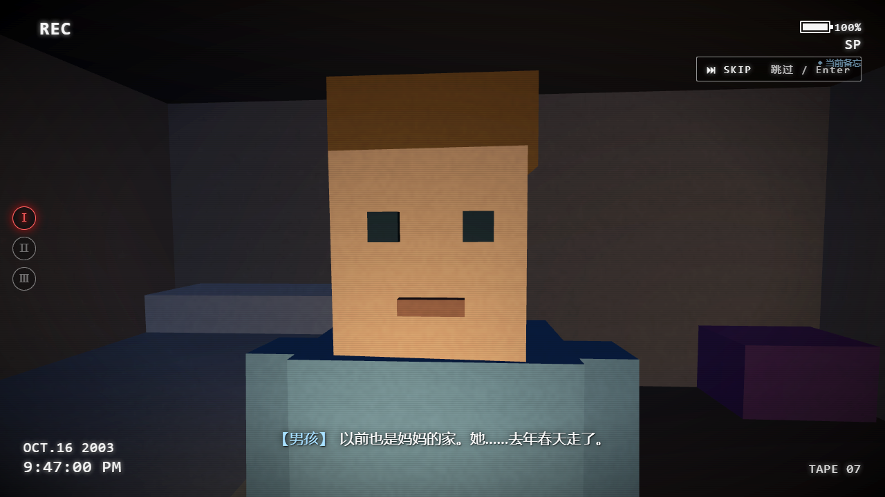
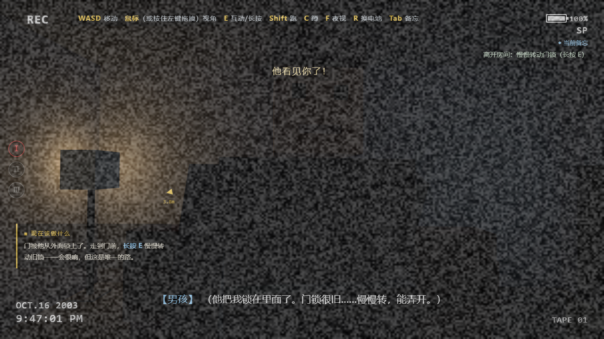
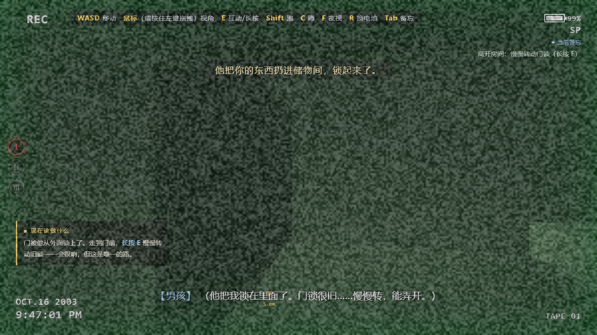
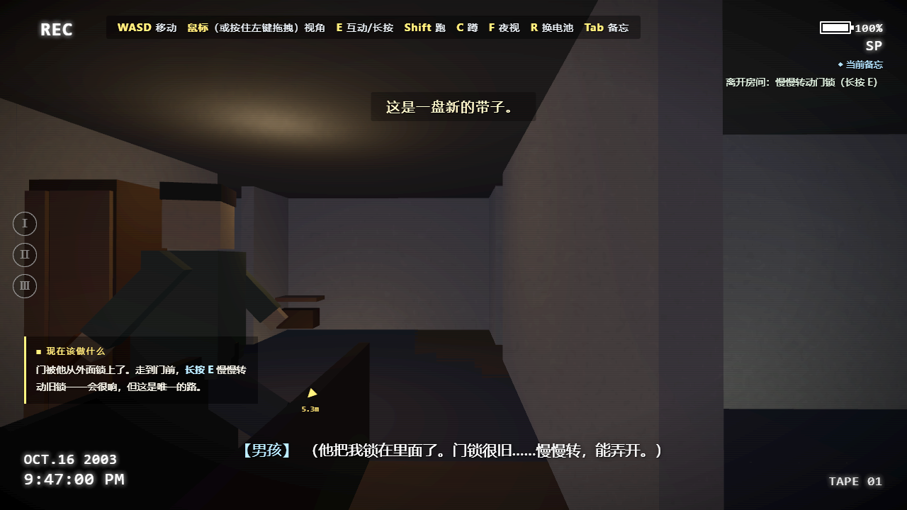
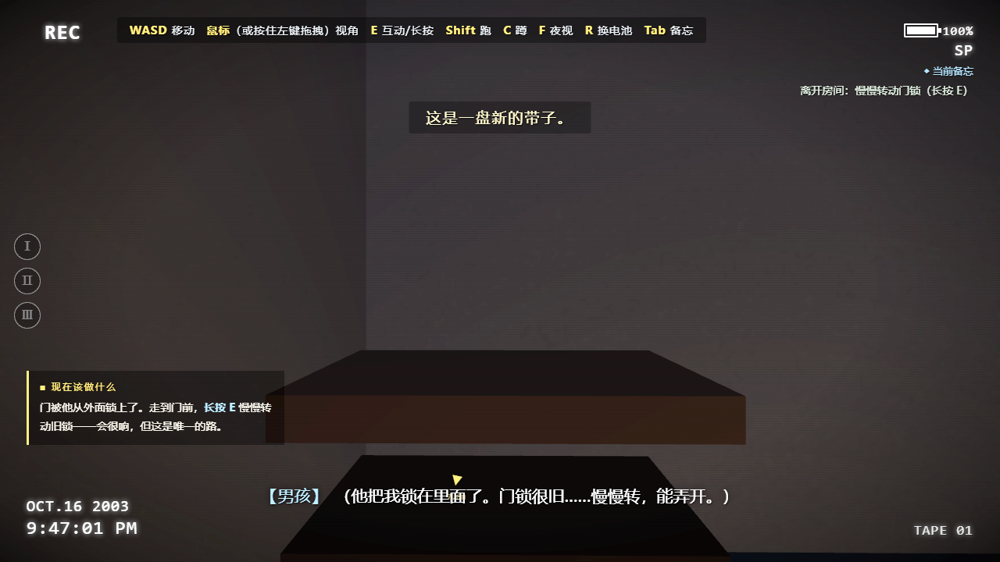
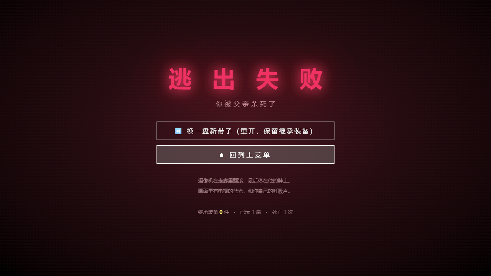
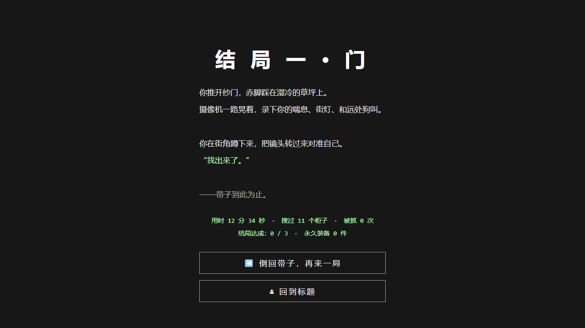

# 爸爸在楼下 · DAD'S DOWNSTAIRS

> 一盘没录完的录像带，一个想逃出这个家的男孩。
> 第一人称家庭恐怖 roguelike · 低多边形 · 全程 DV 录像机视角

**🎮 在线试玩：https://dads-downstairs.app.workbuddy.host/**

打开就能玩，无需安装、无需注册，Chrome / Edge 最佳。
（音频是氛围的一半，进入后请点一下画面并打开声音。）

---


**故事**：妈妈死后，爸爸开始酗酒。他打你，把你锁在房间里，控制你的一切。
你偷出家里那台旧 DV，想录下点什么——也许是证据，也许只是想证明自己还存在。
这盘带子，就是他逃出去的全过程。

---

## 一、核心设计

### 1. 整局游戏 = 一盘录像带

不是"套了个滤镜"，而是**所有机制都长在摄像机上**：

| 机制 | 设计意图 |
| --- | --- |
| 电池 = 照明 | 黑暗中唯一的眼睛是 DV 的夜视，开夜视耗电 ×4。电量见底画面糊成雪花 |
| 时间戳叙事 | HUD 上的日期/时间在推进，玩家能"感到"这一夜在流逝 |
| REC 红点 / 对焦抽搐 / 噪点 / 丢帧 | 紧张时被抓会画面抖动，恐惧直接写在画面上 |
| 结局 = 倒带重放 | 三条结局都以"重放这盘带子"收尾，框架闭环 |

### 2. 父亲 AI（游戏的心脏）

不是按剧本跳出来的惊吓，而是一个**真正在屋里生活的 AI**：

- **状态机**：瘫在沙发喝酒 → 去厨房拿酒 → 上厕所 → 巡逻 → 听到动静去查看 → 拉开衣柜门搜你
- **双重感知**：视觉（视线 + 遮挡判定）+ 听觉（噪音半径，跑步最响、蹲行几乎无声）
- **路点图寻路 + BFS**：两层楼 + 地下室全覆盖，会上下楼梯
- **三阶段演进**：随逃脱进度与噪音累积升级

| 阶段 | 移动速度 | 追击速度 | 视线半径 | 听觉倍率 | 搜柜概率 |
| --- | --- | --- | --- | --- | --- |
| 慵懒 | 1.15 | 2.55 | 8.0 m | ×0.75 | 6% |
| 起疑 | 1.95 | 3.05 | 11.5 m | ×1.00 | 28% |
| 暴怒 | 2.90 | 3.45 | 14.5 m | ×1.25 | 62% |

- **位置自洽的突发惊吓**：电视自己静音、走廊电话突然响、妈妈生前哼的歌从楼上传来……
  这些脚本只在**与父亲真实位置不矛盾**的位置池里抽选——你明明看着他上了楼，厕所里就绝不会钻出他来。

### 3. Roguelike 循环：三振出局

被抓**不会立刻死**——你会被拖回房间，门重新锁上。这正是家暴受害者循环的隐喻。

| 第几次被抓 | 后果 |
| --- | --- |
| 第 1 次 | 没收全部临时道具，扔进上锁的储物间；逃脱进度保留 |
| 第 2 次 | 加强防范：地下室上锁、电话线被拔走藏到别处、巡逻更快更勤 |
| 第 3 次 | **他杀了你**。画面崩成雪花，带子扯断——真正死亡，重开新的一局 |

**跨局继承**：永久装备（爸爸以前给你的开锁工具组、妈妈的旧运动鞋、备忘录涂鸦……）会留在下一盘带子里。
每一局死，你都更了解这个家，也更难被听见。这就是 roguelike 的成长感。

### 4. 三条结局线

| 路线 | 触发条件 | 气质 |
| --- | --- | --- |
| **门** | 书房保险柜 → 大门钥匙（密码藏在照片、母亲日记、账单里）→ 开出大门 | 最"干净"，靠解谜与耐心 |
| **911** | 集齐听筒线 → 修好线路 → 在暴怒巡逻的间隙拨出电话 → 撑到警察到达 | 全作最紧张的猫鼠时段 |
| **停止录制**（隐藏） | 翻到母亲藏在衣柜夹层的日记 → 浴室药柜的安眠药 → 掺进他每晚必喝的威士忌 → 等他睡去 → 走到他面前按下停止录制 | 克制、无声、道德重量最重 |

隐藏线在正常游玩中根本不会暴露——只有读到日记那一页，它才悄然解锁。
全程不拍任何直接画面，只有雪花屏和一跳的日期戳。

### 5. 新手引导

恐怖游戏最怕玩家"不知道该干嘛"。为此做了三层引导：
- **分步目标条**：左下角实时提示"现在该做什么"，完成自动打钩进入下一条
- **目标方位箭头**：屏幕中央黄色箭头指向当前最该去的地方（门锁 / 最近未搜容器 / 保险箱 / 电话……）
- **备忘面板（Tab）**：已搜容器、道具、当前目标一屏可见

---

## 二、操作

| 按键 | 动作 |
| --- | --- |
| `W A S D` | 移动（默认走路） |
| 鼠标 / 按住左键拖拽 | 转视角 |
| `Shift` | **跑步**（快，但很响，会把他引来） |
| `C` | 蹲下潜行（最慢，但几乎无声） |
| `E` | 互动；长按用于撬锁、拆面板等耗时动作 |
| `F` | 夜视模式（耗电 ×4） |
| `R` | 换电池 |
| `Tab` | 备忘 / 目标 |
| `Enter` | 跳过动画 |
| `Esc` | 暂停 |

噪音半径：**跑步 13.5 m > 走路 6.5 m > 蹲行 2.4 m**（装备妈妈的旧运动鞋后整体 ×0.66）。

---

## 三、截图



|  |  |
| --- | --- |
|  |  |
|  |  |
|  |  |
|  |  |

---

## 四、技术说明

- **渲染**：原生 Three.js r160（已 vendored 到 `libs/`，离线可跑），浏览器 ES Modules，**无构建工具、无打包**
- **音频**：WebAudio 全程序化合成——脚步、地板吱呀、开门、玻璃、电视雪花、警笛、倒带声，零音频素材文件
- **语音**：SpeechSynthesis 英文 TTS + 中文字幕，逐句与语音同步推进
- **存档**：localStorage（永久装备、局数、结局达成、死亡数）
- **碰撞**：AABB + 圆形推出，多层安全校验保证绝不穿模出屋
- **资源**：除 three.js 外无任何外部依赖，整个项目可直接丢进任意静态服务器

### 目录结构

```
index.html            入口（HUD / 各类界面 DOM）
css/style.css         DV 机身 UI 与滤镜层样式
js/
  main.js             引导与主循环
  state.js            全局上下文
  world.js            整栋房子（户型、家具、容器、路点、碰撞）
  player.js           第一人称移动、噪音、躲藏
  father.js           父亲 AI（状态机 / 感知 / 寻路 / 三阶段）
  interaction.js      射线交互与长按
  items.js            战利品表、临时道具、永久装备
  game.js             局内流程、三振出局、三条结局
  prologue.js         序章演出
  dv.js               DV 滤镜（噪点 / 扫描线 / 电量 / 雪花 / 夜视）
  audio.js            程序化音效 + TTS
  scares.js           位置自洽的突发惊吓
  tutorial.js         新手引导
  ui.js               字幕 / 提示 / 菜单 / 结算
libs/three.module.js  Three.js r160
docs/                 README 用的截图与动图
```

---

## 五、本地运行

```bash
# 任意静态服务器均可，例如：
python -m http.server 8000
# 浏览器打开 http://127.0.0.1:8000/
```

---

## 六、后续规划

- [ ] 移动端与手柄支持（当前仅桌面键鼠）
- [ ] 父亲的程序化模型升级（现在是方块人，够用但不够好）
- [ ] 更多随机事件与惊吓脚本，提高 roguelike 重玩差异
- [ ] 真人英文配音替换 TTS
- [ ] 更多房间细节与可交互物件

---

题材涉及家庭暴力，表现上刻意克制：不呈现直接暴力画面，压迫感来自声音、影子与事后痕迹。
